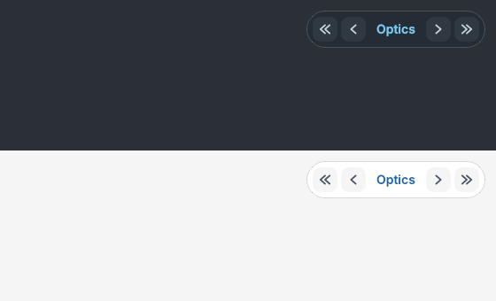

# Quick Deck Switcher

Jump between decks and subdecks in [Anki](https://apps.ankiweb.net/) without going back to the Decks screen.

Quick Deck Switcher adds a small floating bar to the top-right corner of Anki's main window. It works while you review (question or answer side) and on the deck overview / congratulations screen.



```
[ « ]  [ ‹ ]   Current deck   [ › ]  [ » ]
```

| Button | Action | Shortcut |
|---|---|---|
| `«` | Previous top-level deck | `Alt+Shift+←` |
| `‹` | Previous deck in the tree (subdecks included) | `Alt+←` |
| `›` | Next deck in the tree (subdecks included) | `Alt+→` |
| `»` | Next top-level deck, skipping the remaining subdecks | `Alt+Shift+→` |
| | Show / hide the bar | `Alt+N` |

## Features

- Wraps around: after the last deck it goes back to the first one, and vice versa.
- Opens the new deck straight into review if it has cards due; otherwise shows the overview screen.
- Optional mode that only goes through decks with cards due today.
- Follows Anki's light and dark themes automatically.
- Hidden by default. Your choice (Alt+N) is remembered across restarts.
- Navigation shortcuts work even when the bar is hidden, and never fire on the Decks screen.
- English and Portuguese (Brazil). Follows Anki's language by default.

## Installation

**From AnkiWeb:** *Tools › Add-ons › Get Add-ons…* and paste the add-on code from its AnkiWeb page.

**From a file:** download the latest `.ankiaddon` from [Releases](https://github.com/kainanps/quick-deck-switcher/releases), then in Anki go to *Tools › Add-ons › Install from file…* and restart Anki.

Requires Anki 23.10 or later (tested with the 25.09 series).

## Settings

*Tools › Add-ons › Quick Deck Switcher › Config*:

| Key | Values | Default |
|---|---|---|
| `visible` | `true` / `false` (also toggled by Alt+N) | `false` |
| `language` | `"auto"`, `"en"`, `"pt"` | `"auto"` |
| `navigation_mode` | `"all"` (every deck) / `"due"` (cards due today) | `"all"` |
| `include_filtered_decks` | `true` / `false` | `true` |
| `label_mode` | `"short"` (name) / `"path"` (shortened path) | `"short"` |
| `shortcuts` | Qt key sequences, `""` disables one | see above |

The language can also be changed in *Tools › Quick Deck Switcher › Language / Idioma*. On macOS, Alt is the Option key. If a shortcut clashes with something else, change it in the config.

## Development

```
src/quick_deck_switcher/   # the add-on itself (__init__.py, config.json, config.md, manifest.json)
tests/                     # pytest suite; runs the add-on against a real Anki collection with a stubbed aqt
scripts/build.py           # builds dist/quick_deck_switcher-<version>.ankiaddon for AnkiWeb
docs/                      # screenshot and the AnkiWeb description
```

```bash
pip install -r requirements-dev.txt
QT_QPA_PLATFORM=offscreen python -m pytest -q tests
python scripts/build.py
```

To try your local copy in Anki, symlink or copy `src/quick_deck_switcher` into your `addons21` folder (*Tools › Add-ons › View Files*).

**Releasing:** bump `human_version` in `manifest.json`, add an entry to `CHANGELOG.md`, then push a tag such as `v1.1.0`. GitHub Actions runs the tests, builds the `.ankiaddon` and attaches it to the release. Upload that same file to AnkiWeb.

## Feedback

Bug reports and suggestions are welcome in [Issues](https://github.com/kainanps/quick-deck-switcher/issues). When reporting an error, please include the text from Anki's *Copy Debug Info* button.

## License

[MIT](LICENSE) © Kainan Paiva

---

## Português (Brasil)

Navegue entre baralhos e sub-baralhos no Anki sem voltar à tela inicial. Uma barra flutuante no canto superior direito funciona durante a revisão e na tela de resumo/parabéns do baralho.

- `‹` / `›`: baralho anterior / seguinte na árvore (**Alt+←** / **Alt+→**)
- `«` / `»`: baralho raiz anterior / seguinte (**Alt+Shift+←** / **Alt+Shift+→**)
- **Alt+N** mostra ou oculta a barra (a escolha fica salva)
- Navegação circular, modo "só baralhos com cards pendentes" e tema claro/escuro automático
- Idioma em *Ferramentas › Quick Deck Switcher › Idioma*: automático, English ou Português

**Instalação:** pelo AnkiWeb (*Ferramentas › Complementos › Obter complementos…*) ou baixando o `.ankiaddon` em [Releases](https://github.com/kainanps/quick-deck-switcher/releases) e usando *Ferramentas › Complementos › Instalar a partir de arquivo…*.

Problemas e sugestões: [Issues](https://github.com/kainanps/quick-deck-switcher/issues).
