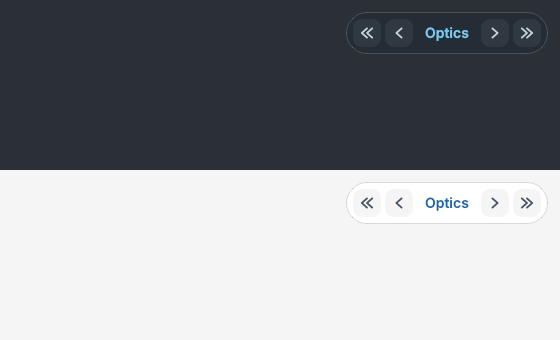

# AnkiWeb listing — Quick Deck Switcher

Copy each field below into the upload form at https://ankiweb.net/shared/addons (Upload button). Upload the `.ankiaddon` built by `scripts/build.py` or attached to the latest GitHub release.

## Title
Quick Deck Switcher – jump between decks & subdecks while reviewing

## Tags
deck navigation shortcuts review subdecks productivity

## Support page
https://github.com/kainanps/quick-deck-switcher/issues

## Description (Markdown — paste everything below the line)

---

**Switch decks without going back to the Decks screen.** Quick Deck Switcher adds a small floating bar to the top-right corner of the main window, so you can move to the previous/next deck or subdeck while reviewing, or from the congratulations screen.

**Features**

- **‹ / ›** – previous / next deck in the deck tree, subdecks included (**Alt+←** / **Alt+→**)
- **« / »** – previous / next top-level deck, skipping the remaining subdecks (**Alt+Shift+←** / **Alt+Shift+→**)
- Wraps around: after the last deck it goes back to the first one
- Opens the deck straight into review if it has cards due, otherwise shows the overview screen
- Optional mode that only goes through decks with cards due today
- Works on the question side, the answer side and the congratulations screen
- Follows Anki's light/dark theme automatically
- Shortcuts keep working even when the bar is hidden (they never fire on the Decks screen)
- **English and Português (Brasil)** – follows Anki's language by default

**How to use**

1. Open any deck and press **Alt+N** (or *Tools › Quick Deck Switcher › Show deck switcher bar*).
2. Use the buttons or the shortcuts above.
3. Your choice is remembered after restarting Anki.

**Settings** – *Tools › Add-ons › Quick Deck Switcher › Config*: navigation mode (all decks / decks with cards due), filtered decks, short name or full path, language and every shortcut. On macOS, Alt is the Option key; you can change any shortcut in the config.

Compatible with Anki 23.10 and later (tested with the 25.09 series).

**Source code, changelog and bug reports:** https://github.com/kainanps/quick-deck-switcher

---

**Português (Brasil)**

Troque de baralho sem voltar à tela inicial. O Quick Deck Switcher adiciona uma pequena barra flutuante no canto superior direito para ir ao baralho ou sub-baralho anterior/seguinte durante a revisão ou na tela de parabéns.

- **‹ / ›** – baralho anterior / seguinte na árvore (**Alt+←** / **Alt+→**)
- **« / »** – baralho raiz anterior / seguinte (**Alt+Shift+←** / **Alt+Shift+→**)
- **Alt+N** mostra ou oculta a barra (a escolha fica salva)
- Navegação circular, modo "só baralhos com cards pendentes", tema claro/escuro automático
- Idioma: *Ferramentas › Quick Deck Switcher › Idioma* (automático, English ou Português)
